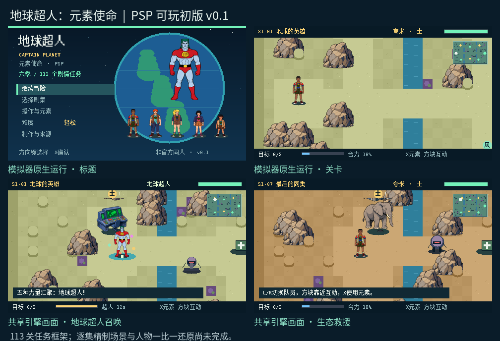

# Captain Planet PSP — Element Mission

**Early PSP homebrew experiment · C / PSPSDK · 480 × 272 · Community contributions welcome**

> **Rights notice — read before distributing:** This is an **unofficial, unlicensed fan prototype** inspired by *Captain Planet and the Planeteers*. It is not approved by or affiliated with the original rights holders. The TV characters, names, story world and related protected elements are **not offered under an open-source license**. Do not redistribute game builds, character art, episode adaptations, or branded materials on the assumption that a code license covers them. See [Rights & licensing](RIGHTS_AND_LICENSING.md) and [Rights audit](docs/RIGHTS_AUDIT.md). No statement here guarantees that a particular use is lawful.



## What is this project?

An AI-assisted, community-oriented experiment in creating an adventure game for the original Sony PSP. Kyle initiated the idea, directed the gameplay and visual goals, and used ChatGPT to help implement the initial version.

The repository contains a **v0.1 gameplay prototype**, **not** 113 completed episodes. Its episode catalog has 113 entries, but the playable tasks share ten systems and procedural maps. Most characters, unique bosses, dialogue and episode-specific missions remain unfinished.

### Available in the current v0.1 baseline

- Native C / PSPSDK game framework, PSP-sized display and Chinese-language interface
- Five selectable Planeteers and elemental combat
- Temporary Captain Planet summon, energy and health systems
- Mission interaction, map, pause, checkpoint-style progress, and save/backup recovery
- Episode catalog for six seasons / 113 entries using shared mission templates
- Initial PPSSPP emulator boot, input, rendering and regression-test evidence

### Not yet verified or complete

- Real PSP hardware compatibility, performance, long-play stability or battery behavior
- End-to-end combat balance and distinct authored layouts for all 113 entries
- Episode-accurate characters, animation, villains, cutscenes or narrative
- Rights clearance for the original show's characters, plot elements or fan-art derivatives

**Current priority: build one credible vertical slice of episode 1, “A Hero for Earth,” before expanding the campaign.** See [Episode 1 vertical-slice specification](docs/EPISODE01_VERTICAL_SLICE.md).

## Contributing

We welcome help with **original engine code, accessibility, game design systems, testing and technical documentation**. Open an [issue](../../issues) for a small scoped improvement, or read the [contribution guide](CONTRIBUTING.md) before submitting a pull request.

Especially useful: PSP hardware testing, stable frame rate, collision and control polish, reproducible bugs, and **original or properly licensed** generic effects and environment assets. Please **do not upload copied TV screenshots, episodes, copyrighted audio or unlicensed character likenesses**.

We have not obtained clearance to authorize reuse of the show IP. If you want to contribute a character or story adaptation, **discuss the rights situation first** rather than assuming your contribution can be redistributed.

## Developer build and testing

With PSPSDK installed and `PSPDEV` configured:

```sh
make
```

Host logic/render tests on Linux with GCC and the checked-in generated assets:

```sh
gcc -std=c99 -O1 -g -fsanitize=address,undefined -Wno-unused-variable \
  tests/test_game.c src/game.c src/render.c -lm -o tests/test_game
ASAN_OPTIONS=detect_leaks=0 ./tests/test_game
```

The tests do **not** establish PSP hardware performance or rights clearance. Build/test instructions: [docs/INSTALL_AND_BUILD.md](docs/INSTALL_AND_BUILD.md) (currently Chinese). Existing test evidence: [docs/BUILD_REPORT.md](docs/BUILD_REPORT.md).

The v0.1 repository also contains a historical game ZIP and character-based assets. Their inclusion **does not** mean we are authorized to license or encourage redistribution of them. **Do not repost or mirror those files.** The release/distribution decision remains on hold pending a rights review.

## Licensing and provenance

- **MIT**: only the original, copyrightable source code expressly identified in [RIGHTS_AND_LICENSING.md](RIGHTS_AND_LICENSING.md), to the extent the project contributors own or can license it.
- **Separate / unverified rights**: all third-party or derived characters, episode text, images, sprites, generated assets, fonts and third-party datasets. See [rights audit](docs/RIGHTS_AUDIT.md), [sources](docs/SOURCES.md) and [font notices](licenses/).
- A code license **does not authorize** use of *Captain Planet* intellectual property. Noncommercial status and attribution do not replace permission.

## Project credits

Initiated and directed by Kyle Zhang. The initial prototype code and art workflow were developed with substantial ChatGPT assistance; attribution does not establish exclusive human copyright in AI-only material. Thanks to contributors who help with code, testing, and clearly sourced, rights-safe materials.

[中文历史说明](README.zh-CN.md) · [Contribution guide](CONTRIBUTING.md) · [Rights & licensing](RIGHTS_AND_LICENSING.md)
